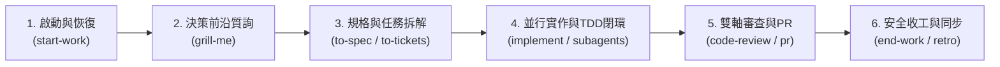

# CK 全生命週期工程工作流（CK Workflow Skill）

本技能為 CK（建國）客製之 Master Orchestrator（總體工作流指揮技能），將外圍生命週期治理（`project-init`、`start-work`、`end-work`）與核心工程推進管線（`grill-me`、`to-spec`、`to-tickets`、`implement`、`code-review`、`pr`、`retro`）無縫串接。

---

## 🔴 核心鐵律與確認閘門（Absolute Guardrails）

無論任何階段，必須嚴格遵守以下確認閘門與安全規範：

1. **檔案寫入確認（Write Gate）**：建立新檔案或修改現有程式碼前，必須提供差異預覽，**取得 CK 明確確認後方可寫檔**。
2. **Git Commit 確認（Commit Gate）**：每次提交前必須提出 commit 訊息草稿，**取得 CK 明確確認後方可執行 commit**。
3. **Git Push 與分支確認（Push & Branch Gate）**：未經 CK 明確指示，**嚴禁自動 push、建立分支、切換分支或建立 PR**。
4. **機密安全阻擋（Secret Scanning Gate）**：嚴禁將 API Key、Token、密碼、私鑰、憑證或敏感個資寫入檔案、commit、PR 或交接檔。
5. **安全編碼準則（Defensive Coding Gate）**：強制落實縱深防禦（禁止 `eval()`、動態代碼執行；防範 SQL/Shell 命令注入；前端防 XSS；路徑白名單驗證）。
6. **三層同步架構（Three-Tier Sync）**：
   - **L1 本地**：工作樹與 `.agent/HANDOFF.md`（HANDOFF v1）。
   - **L2 GitHub**：遠端 Repository。
   - **L3 Obsidian**：透過 Obsidian MCP 連線至個人知識庫，自動同步規格與決策。

---

## 工作流六大推進階段 (Phases)

### 階段一：啟動與恢復 (Boot & Resume)
- **觸發時機**：開啟新專案或開始新工作會話。
- **動作**：
  1. 調用 `start-work`（或 `project-init`）。
  2. 唯讀比對 L1 `.agent/HANDOFF.md` 基準 commit 與目前工作樹。
  3. 檢視 L2 Git 狀態與 L3 Obsidian 上次筆記脈絡。
  4. 輸出結構化恢復摘要，等待 CK 指示。

### 階段二：架構質詢與共識收斂 (Align & Grill)
- **觸發時機**：面對複雜需求、架構重構或技術選型時。
- **動作**：
  1. 啟用 `grill-me` 決策樹質詢，挑戰潛在假設與邊界。
  2. 聚焦當前決策前沿（Decision Frontier），分輪提問並附帶建議選項。
  3. 自行查證既有程式庫與工具事實，僅將業務取捨交由 CK 裁決。
  4. 同步維護專案術語（`GLOSSARY.md`）與架構決策（ADR）。

### 階段三：規格提煉與示蹤彈拆解 (Blueprint & Decomposition)
- **觸發時機**：架構共識達成，準備進入工程實作前。
- **動作**：
  1. 調用 `to-spec`：鎖定最高測試縫隙（Seams），產出包含使用者故事與驗收條件的規格書。
  2. 調用 `to-tickets`：將規格拆解為端到端垂直切片（Tracer-bullet）任務票券，建立有向無環任務圖（Task Graph）並標明阻塞依賴（Blocked by）。
  3. **閘門確認**：展示規格與票券預覽，**取得 CK 確認後**才寫入 `.agent/tickets/`。

### 階段四：Subagent 並行實作與 TDD 閉環 (Build & Parallel TDD)
- **觸發時機**：任務票券已建立，準備推進任務圖中的前沿任務（Frontier）。
- **並行派發原則**：
  1. **前沿檢測**：分析任務圖，僅對前置依賴全部滿足且**明確無相依性（Independent）**的任務啟動並行。
  2. **並行上限**：**嚴格限制並行 Subagent 數量為 2～3 個**，避免 context 混亂與資源過載。
  3. **沙盒隔離**：Subagents 一律以 `Workspace: "branch"` 啟動獨立工作區，在沙盒中獨立執行 TDD 紅綠重構循環。
  4. **禁止 Subagent 自行寫入主樹或 Commit**：Subagents 僅回報代碼差異（Diff）與測試驗證數據。
  5. **主 Agent 集中守門與確認閘門**：
     - 主 Agent（Jenny）收集各 Subagents 的變更成果，檢測潛在衝突。
     - 向 CK 呈報結構化預覽（異動檔案清單、Diff 摘要、測試結果、Commit 訊息草稿）。
     - **取得 CK 明確確認後**，主 Agent 才統一將變更套用至主工作區並執行 `git commit`。

### 階段五：雙軸審查與變更說明 (Gatekeeping & PR)
- **觸發時機**：所有前沿票券完成或整套規格實作完畢時。
- **動作**：
  1. 調用 `code-review` 執行雙軸平行審查：
     - **Standards（代碼標準）**：符合專案代碼風格、無 code smell、落實安全防線。
     - **Spec（規格達成）**：100% 覆蓋驗收條件，無多餘或偏離需求之改動。
  2. 調用 `pr` 產出結構化變更說明（最小視覺圖、前後實證數據、單向門/雙向門、爆炸半徑）。
  3. **閘門確認**：展示 PR 草稿，**取得 CK 確認後方可進行後續推送或建立 PR**。

### 階段六：安全收工與知識沉澱 (Sync & Park)
- **觸發時機**：當 CK 表示「收工」、「今天先到這裡」或階段性目標完成。
- **動作**：
  1. 調用 `end-work` 進行機密安全掃描（若含敏感 Key 立即阻擋）。
  2. 產出 HANDOFF v1 差異預覽。
  3. 透過 Obsidian MCP 將重大架構決策、踩坑紀錄與工作進度寫入 L3 Obsidian 知識庫。
  4. 可選執行 `retro` 提出開發環境優化建議。
  5. **閘門確認**：**取得 CK 明確確認後**寫入 `.agent/HANDOFF.md`，並個別確認是否 commit 與 push。

---

## 常用操作指引

- **完整走查**：對 Jenny 說「執行 CK 工作流」或「依照 ck-workflow 推進」。
- **單項調用**：工作流中的各個子模組（`grill-me`, `to-spec`, `to-tickets`, `implement`, `code-review`, `pr`, `end-work`）均可獨立手動調用。
